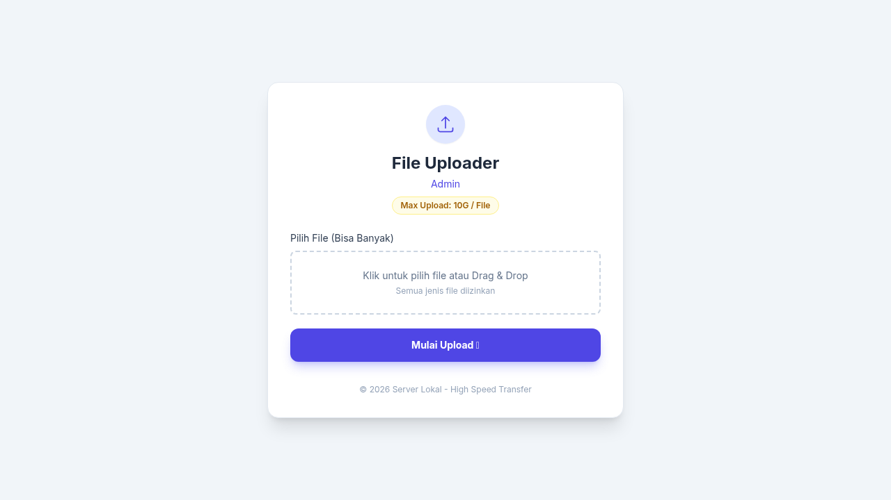
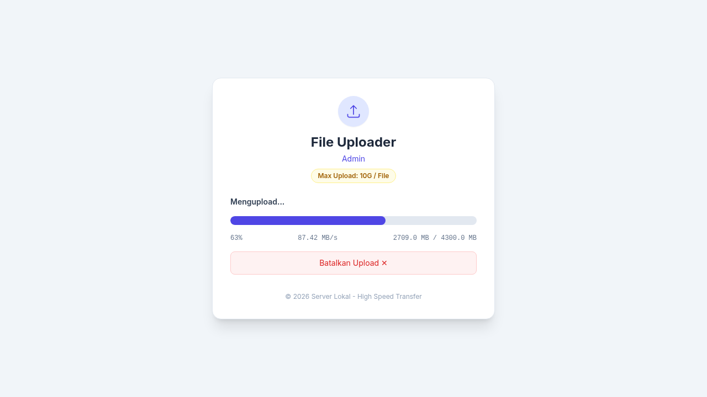
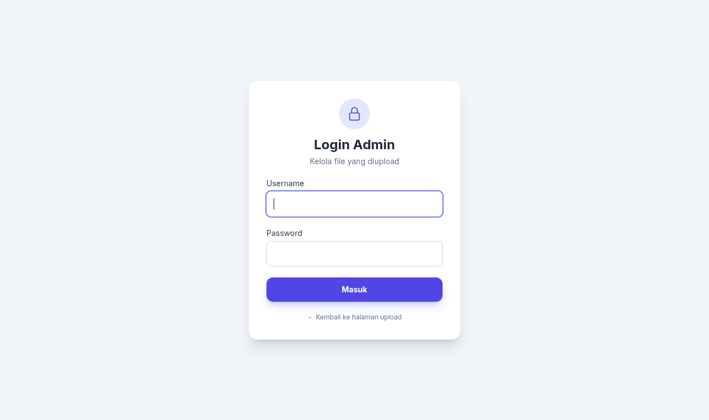
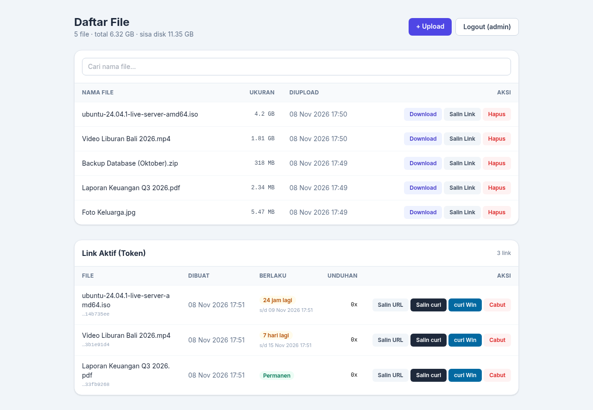
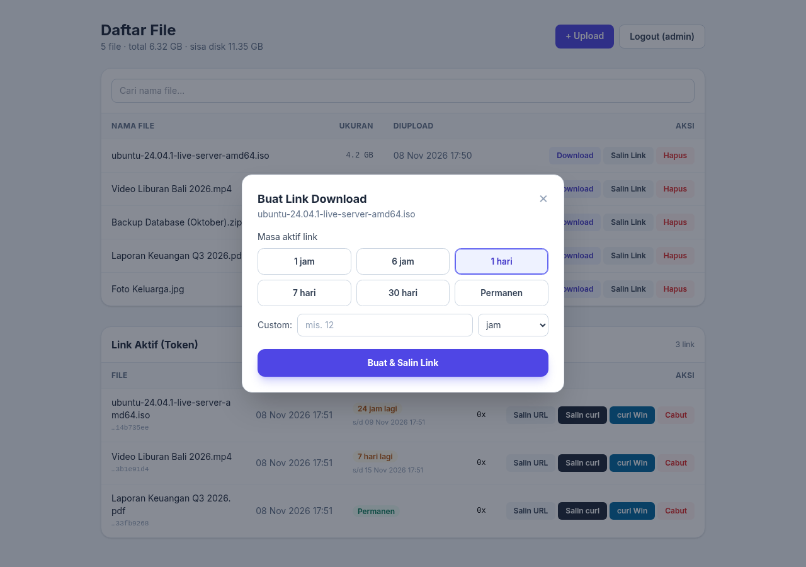
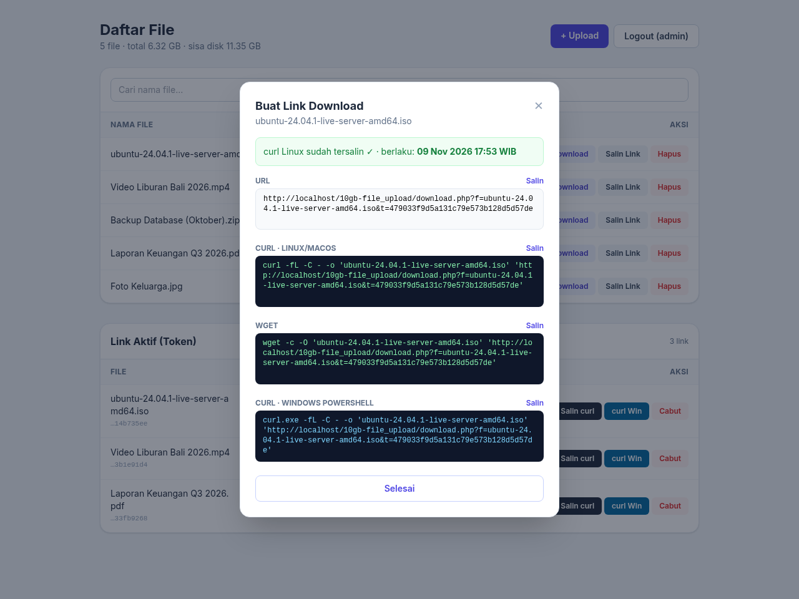

# 10gb-file_upload

Upload sampai 10 GB per file, bisa banyak file sekaligus. File disimpan dengan nama dan format aslinya di `files_upload/`.
Halaman admin berisi daftar file, tombol download dan hapus, plus link download bertoken yang bisa langsung di-curl.

- Halaman upload: `http://IP/10gb-file_upload/`
- Halaman admin: `http://IP/10gb-file_upload/admin.php`
- Login default: `admin` / `x6dnMKpewVWNXDym` (bisa diganti di `data/admin.json`)

---

## Screenshot

**Halaman upload**: pilih banyak file atau drag & drop, lalu progress upload

<p>
  
  
</p>

**Halaman admin**: login, lalu daftar file dan link aktif

<p>
  
  
</p>

**Salin Link**: pilih masa aktif, lalu perintah curl / wget / curl Windows siap di-copy

<p>
  
  
</p>

---

## Windows (XAMPP)

```bat
:: 1. Taruh folder ini ke htdocs XAMPP
cd C:\xampp\htdocs
git clone https://github.com/xccvme/10gb-file_upload.git
::    (atau download ZIP lalu extract jadi C:\xampp\htdocs\10gb-file_upload)

:: 2. Buka php.ini
notepad C:\xampp\php\php.ini
```

Cari dan ubah baris ini di `php.ini`:

```ini
upload_max_filesize = 10G
post_max_size = 0          ; 0 = tanpa batas total (untuk upload banyak file sekaligus)
max_file_uploads = 100
max_execution_time = 0
max_input_time = -1
```

```bat
:: 3. Restart Apache: XAMPP Control Panel -> Apache -> Stop -> Start
:: 4. Buka di browser
start http://localhost/10gb-file_upload/
```

---

## Linux (Ubuntu / Debian)

```bash
# 1. Install Apache + PHP (sekali saja)
sudo apt update && sudo apt install -y apache2 libapache2-mod-php git

# 2. Clone ke folder mana saja sesuai keinginan
cd /opt                                   # ganti dengan folder pilihanmu
sudo git clone https://github.com/xccvme/10gb-file_upload.git
cd 10gb-file_upload
sudo chown -R www-data:www-data files_upload data

# 3. Daftarkan folder ini ke Apache -> http://IP-SERVER/10gb-file_upload/
printf 'Alias /10gb-file_upload %s\n<Directory %s>\n    AllowOverride All\n    Require all granted\n</Directory>\n' "$PWD" "$PWD" | sudo tee /etc/apache2/conf-available/10gb-file_upload.conf
sudo a2enconf 10gb-file_upload

# 4. Naikkan batas upload ke 10 GB di php.ini
PHPINI=$(ls /etc/php/*/apache2/php.ini)
sudo sed -i -E 's/^upload_max_filesize.*/upload_max_filesize = 10G/; s/^post_max_size.*/post_max_size = 0/; s/^max_file_uploads.*/max_file_uploads = 100/; s/^max_execution_time.*/max_execution_time = 0/; s/^max_input_time.*/max_input_time = -1/' $PHPINI
grep -E '^(upload_max_filesize|post_max_size|max_file_uploads|max_execution_time|max_input_time)' $PHPINI   # cek hasilnya

# 5. Restart Apache, lalu buka http://IP-SERVER/10gb-file_upload/
sudo systemctl restart apache2
hostname -I
```

> Kalau foldernya di dalam `/root` atau `/home/nama`, beri Apache izin untuk lewat:
> `sudo apt install -y acl && sudo setfacl -m u:www-data:x /root` (ganti `/root` dengan folder induknya)

---

## Ganti login admin

```bash
nano data/admin.json            # Linux
notepad data\admin.json         # Windows
```

```json
{ "username": "admin", "password": "x6dnMKpewVWNXDym" }
```

Perubahan langsung berlaku tanpa perlu restart.

---

## Upload lewat CLI

```bash
# Upload satu atau beberapa file sekaligus (Linux)
curl -F "filesToUpload[]=@video.mp4" -F "filesToUpload[]=@backup.zip" http://IP/10gb-file_upload/
```

```bat
:: Windows (PowerShell / CMD): pakai curl.exe
curl.exe -F "filesToUpload[]=@C:\Users\boss\Videos\video.mp4" http://IP/10gb-file_upload/
```

Kalau sudah ada file dengan nama yang sama, file baru otomatis jadi `video (1).mp4`. File lama tidak tertimpa.

---

## Download lewat CLI (link bertoken)

Caranya: buka Admin, klik **Salin Link** pada file, pilih masa aktif, lalu klik **Buat & Salin Link**.

```bash
# Linux (-C - / -c = lanjutkan download kalau terputus)
curl -fL -C - -o 'video.mp4' 'http://IP/10gb-file_upload/download.php?f=video.mp4&t=TOKEN'
wget -c -O 'video.mp4' 'http://IP/10gb-file_upload/download.php?f=video.mp4&t=TOKEN'
```

```powershell
# Windows PowerShell
curl.exe -fL -C - -o 'video.mp4' 'http://IP/10gb-file_upload/download.php?f=video.mp4&t=TOKEN'
```

Link yang sudah kedaluwarsa atau dicabut (tombol **Cabut** di Admin) akan dijawab `403`.

---

## Kalau ada masalah

Kalau setting php.ini atau .htaccess belum benar, halaman upload dan admin akan menampilkan peringatan kuning.

```bash
# Upload > 1 GB gagal / folder data/ bisa dibuka dari browser -> .htaccess belum aktif (Linux: ulangi langkah 3)
# Upload gagal di tengah jalan -> cek sisa disk
df -h
# Lihat error Apache
sudo tail -n 30 /var/log/apache2/error.log          # Linux
type C:\xampp\apache\logs\error.log                  :: Windows
```
